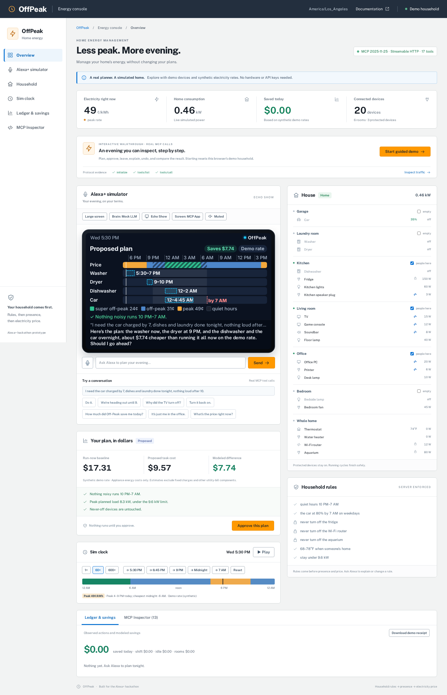
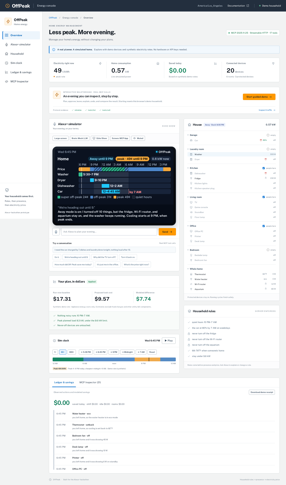
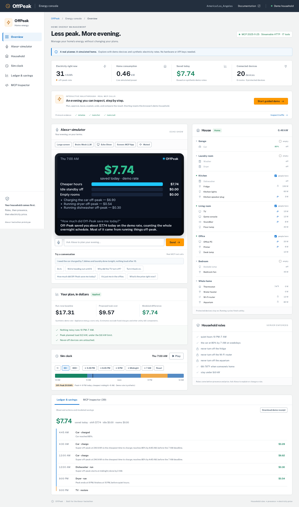
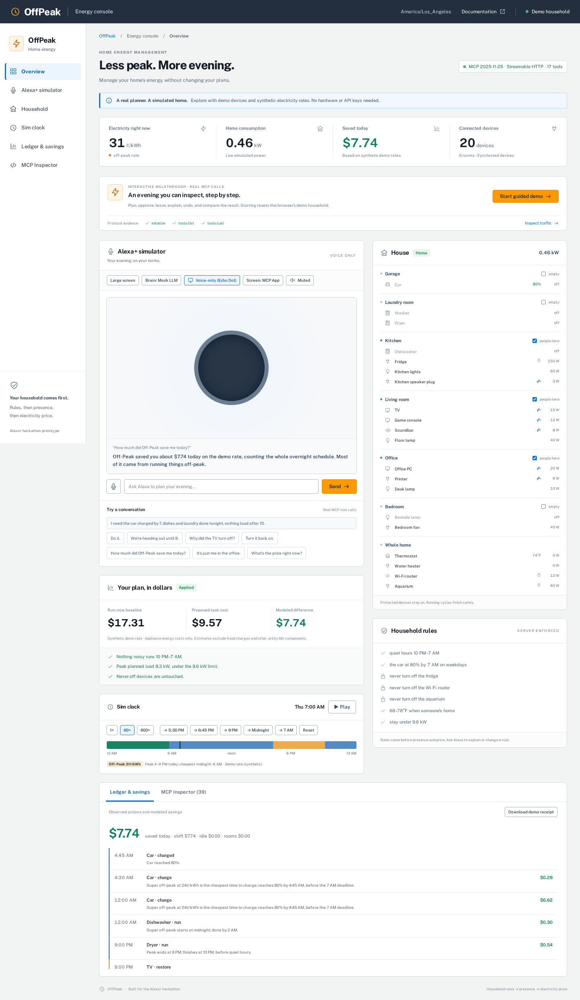
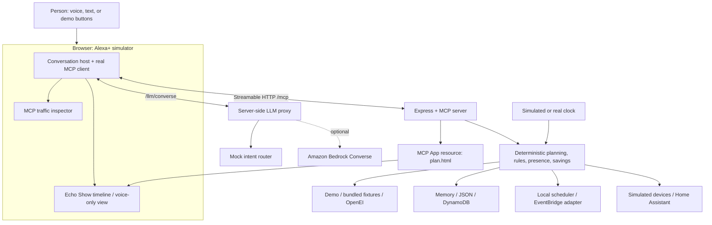

<p align="center">
  
</p>

<h1 align="center">Off-Peak</h1>

<p align="center"><strong>Cut my power bill without wrecking my evening.</strong><br>Household rules come first. A deterministic planner schedules. MCP connects the conversation.</p>

<p align="center">
  <a href="LICENSE"></a>
  <a href="#mcp-tools-and-resources"></a>
  <a href="#quick-start"></a>
  
</p>

Built for the **Alexa+ hackathon track**. Off-Peak combines the household's electricity tariff, appliance deadlines, and room usage into an explainable schedule through a real Model Context Protocol server and a browser-based Alexa+ simulator.

**[Open the live OffPeak demo →](https://offpeak.patrickvaldivia123.workers.dev)**

## What Off-Peak can do for you

- **Run the washer or dishwasher when power is cheapest.** Ask **“Alexa, run the washer when power is cheapest”** or **“Alexa, run the dishwasher when power is cheapest.”** Off-Peak proposes the lowest-cost feasible time within its planning window, respecting quiet hours, deadlines and household power limits.
- **Charge the car before you need it.** Ask **“Charge the car to 80% by 7 AM.”** Off-Peak plans charging around cheaper electricity while meeting the target and deadline.
- **Save energy when rooms are empty.** Say **“We're heading out until 9”** or **“It's just me in the office.”** Off-Peak reduces unnecessary power use while preserving protected devices and running cycles.
- **Explain changes and show modeled savings.** Ask why a device turned off, undo that action, or see how much the simulated household saved.

For an appliance request, review the proposed schedule, then say **“Alexa, do it”** or click **Approve this plan**. Each request plans one cycle; recurring “always run at the cheapest time” automation is not yet implemented. The public demo uses simulated appliances and clearly labeled synthetic electricity rates.

**Status: hackathon prototype with a public demo and an offline local demo.** The AWS-inspired energy console preserves the simulator, deterministic planner, all 17 MCP tools, voice/screen controls, room occupancy, simulated clock, ledger, and traffic inspector. The public demo runs on Cloudflare Workers with a separate simulated household per visitor. Alexa+ is simulated here; the repository is not connected to an Echo device or the Alexa developer console. The optional AWS CDK deployment and real-device operation still require account-specific setup. See [current boundaries](#current-boundaries).

## Why Off-Peak exists

Electricity prices change throughout the day, but the household still needs clean clothes, a charged car, and a comfortable evening. A cheaper schedule is useful only if it respects those needs.

Off-Peak combines the household's time-of-use tariff, appliance requirements, room usage, and explicit rules into a plan people can understand and approve. It can move flexible loads into cheaper hours, reduce standby power in empty rooms, explain an action, and restore the state it changed.

Its decision order is:

**Household rules → presence → electricity price.**

The planner and money calculations are deterministic TypeScript. A language model can interpret a request and phrase a response, but it does not invent the electricity price, choose an unvalidated schedule, or calculate the saving.

## Contents

- [See it in action](#see-it-in-action)
- [What it can do](#what-it-can-do)
- [Quick start](#quick-start)
- [Demo walkthrough](#demo-walkthrough)
- [Architecture](#architecture)
- [MCP tools and resources](#mcp-tools-and-resources)
- [Configuration](#configuration)
- [Optional integrations](#optional-integrations)
- [Free Cloudflare deployment](#free-cloudflare-deployment)
- [AWS deployment](#aws-deployment)
- [Tariffs and savings](#tariffs-and-savings)
- [Development and testing](#development-and-testing)
- [Repository map](#repository-map)
- [Security and privacy](#security-and-privacy)
- [Troubleshooting](#troubleshooting)
- [Current boundaries](#current-boundaries)
- [Contributing](#contributing)
- [License](#license)

## See it in action

### Judge walkthrough

Click **Start guided demo** in the [live console](https://offpeak.patrickvaldivia123.workers.dev). The seven scenes walk through proposing, approving, leaving, explaining, undoing, overnight results and office-only mode. Starting resets only this browser's disposable demo household. All original controls remain available.

**Your plan, in dollars** shows the actual planner's run-now task cost, proposed cost and modeled difference with its server-computed rule checks. **Approve this plan** explicitly schedules it. The server rejects unresolved conflicts, superseded proposals, stale start times, and changes to household rules or tariffs.

Use **Large screen** for an Echo Show presentation view and Escape to exit. **Download demo receipt** exports observed protocol operations, labeled costs, rule checks and protected-device state without raw RPC payloads or conversation captions. `npm run verify:submission` performs an independent live protocol/tool check and saves a local JSON report.

The [hackathon readiness checklist](docs/hackathon-readiness.md) maps this work to the [official rules](https://amazonappdev2026.devpost.com/rules). The deadline is **Friday, October 23, 2026 at noon PDT**. [SUBMISSION.md](SUBMISSION.md) contains prepared entry text. A public video URL, team declarations and final Devpost submission remain.

The additional MIT [tou-rates repository](https://github.com/Darthh/tou-rates) is public, with standalone tests and an independent build. No npm registry release is claimed. The public Cloudflare demo does not establish live AWS-service use.



*Captured from the Workers build (`npm run dev:worker`) in mock LLM mode on October 21, 2026. The light console uses AWS-style navigation, panels, and orange primary actions; the simulated device is a dark 16:10 Echo Show screen authored at its 960×600 size (every text size ≥ 24 px) and scaled to fit. The embedded timeline is the real MCP App, the header shows the negotiated protocol and transport, and electricity rates and savings are explicitly synthetic.*

> “I need the car charged by 7, dishes and laundry done tonight, nothing loud after 10.”

Off-Peak proposes the washer now, the dryer at 9 PM, and the dishwasher and car overnight. It asks before applying the plan, shows the schedule and its spoken reply on an Echo Show screen, and explains the price and household constraints behind it.

<details>
<summary><strong>More screens: away mode, savings, and voice-only</strong></summary>

| Away mode | Savings | Voice-only view |
| --- | --- | --- |
|  |  |  |

</details>

## What it can do

| Capability | What happens | Where it lives |
| --- | --- | --- |
| **Price-aware planning** | Coordinates EV charging, dishwasher, washer, and dryer around time-of-use prices. | [`core/planner.ts`](packages/core/src/planner.ts) |
| **Household guardrails** | Checks deadlines, quiet hours, washer-before-dryer dependencies, and a household load limit. Infeasible requests return conflicts and alternatives. | [`core`](packages/core/src), [`services/plans.ts`](packages/server/src/services/plans.ts) |
| **Presence modes** | Supports home, away, sleep, and active-room modes, plus arrival scheduling and idle-off behavior. | [`services/presence.ts`](packages/server/src/services/presence.ts) |
| **Protected devices** | Automatic presence actions preserve never-off devices and running cycles. Explicit protected-device off requests require confirmation. | [`core/presence.ts`](packages/core/src/presence.ts), [`services/control.ts`](packages/server/src/services/control.ts) |
| **Explain and undo** | Records actions and reasons in a ledger and restores recorded previous state where supported. | [`services/trust.ts`](packages/server/src/services/trust.ts) |
| **Savings breakdown** | Separates load shifting, idle savings, and room/away savings; flags modeled estimates. | [`core/savings.ts`](packages/core/src/savings.ts) |
| **Real MCP traffic** | Browser performs initialization, tool discovery, tool calls, and resource reads over Streamable HTTP. | [`web/lib/mcp.ts`](packages/web/src/lib/mcp.ts) |
| **Screen and voice** | A 960×600 Echo Show screen (dark, ≥ 24 px type, on-screen captions) that scales from phone to Large screen, an Echo Dot voice-only view, text input, push-to-talk, browser speech, and optional Polly. Every tool reply is speakable: units in words, money under a dollar in cents, no IDs. | [`web`](packages/web), [`ui-apps`](packages/ui-apps) |
| **Offline fallback** | Bundled tariffs, simulated devices, simulated time, mock LLM, and scripted intent routing keep the text demo local. | [`fixtures`](fixtures), [`core/intents.ts`](packages/core/src/intents.ts) |

## Quick start

### Requirements

- **Node.js 22.18 or newer.** The server executes TypeScript using Node's native type stripping.
- **npm** with workspace support and **Git**.
- A modern browser. Text input is always available; speech input depends on browser support and microphone permission.

### Install and run

```bash
git clone https://github.com/Darthh/AWS-Alexa-Hackathon.git
cd AWS-Alexa-Hackathon
npm ci
npm run dev        # optional first: cp .env.example .env
```

Open **<http://localhost:5173>**.

The defaults use demo tariffs, simulated devices and time, JSON persistence, a local scheduler, and the mock LLM. **No AWS credentials, OpenEI key, smart-home hardware, or Alexa device are required for this path.** Dependencies must be downloaded during installation; browser speech services may have their own network requirements.

| Local address | Purpose |
| --- | --- |
| `http://localhost:5173` | Alexa+ simulator and developer panels |
| `http://localhost:8787/mcp` | MCP Streamable HTTP endpoint |
| `http://localhost:8787/health` | Server health and clock state |

`npm run dev` builds the single-file MCP App, then starts the server and web client. **Ctrl+C** stops both processes. The simulator clock starts paused so the demo does not run away while you explain it.

<details>
<summary><strong>Useful alternate demo modes</strong></summary>

| URL | What changes |
| --- | --- |
| `http://localhost:5173/?mode=scripted` | Bypasses the LLM loop and maps supported phrases directly to real MCP calls. |
| `http://localhost:5173/?ui=native` | Renders tool output natively instead of using the MCP App iframe. |
| `http://localhost:5173/?mode=scripted&ui=native` | Combines both fallbacks for a predictable demonstration. |

The **Brain**, **Screen**, **Echo Show / Voice-only**, and **Voice / Muted** controls are available in the **Alexa+ simulator** toolbar. Hold the microphone button or spacebar for push-to-talk when the browser supports speech recognition; type or use the example buttons otherwise. The sidebar jumps to every console panel, including **Ledger & savings** and **MCP Inspector**.

</details>

## Demo walkthrough

Use a fresh default demo state or the **Reset** button in **Sim clock**. Reset clears the current demo household, plans, jobs, ledger, and related stored state. It is intended for the simulator.

### The seeded household

- **20 devices** across six rooms and a shared **Whole home** zone.
- EV starts at **35%**; the weekday rule requests **80% by 7 AM**.
- No noisy appliances from **10 PM to 7 AM**.
- Household load limit: **9.6 kW**.
- Fridge, Wi-Fi router, and aquarium are protected never-off devices.
- Default timezone: **America/Los_Angeles**.
- Simulated time begins at the most recent weekday **5:30 PM**, paused; default playback is **60×**.

The authoritative seed is [`fixtures/demo-home.json`](fixtures/demo-home.json).

### A short presentation sequence

For a single appliance, type **“Alexa, run the dishwasher when power is cheapest.”** Off-Peak proposes the lowest-cost feasible cycle within its planning window while respecting household rules. Say **“Do it”** (or **“Alexa, do it”**) or click **Approve this plan** to schedule it. In the default synthetic weekday demo, it runs midnight–2 AM, about $0.30 cheaper than starting at 5:30 PM. Asking **“When is the cheapest time to run the dishwasher?”** only returns timing information and creates no plan. This works in both mock conversation and scripted mode; actual Alexa/Echo and dishwasher hardware are not connected to the public simulator.

| Step | Say, type, or click | What to show |
| --- | --- | --- |
| **1. Make a plan** | “I need the car charged by 7, dishes and laundry done tonight, nothing loud after 10.” | Proposed timeline, constraint checks, and the request for confirmation. The demo already includes the quiet-hours rule. |
| **2. Confirm** | “Do it.” | Plan applied; washer starts; future steps become scheduled. |
| **3. Leave home** | Jump to **6:45 PM**, then “We're heading out until 9.” | Standby/room changes, protected devices left on, and the running washer preserved. |
| **4. Inspect trust** | “Why did the TV turn off?” then “Turn it back on.” | Recorded explanation followed by undo of that action. |
| **5. Use one room** | “It's just me in the office.” | Active-room mode and devices outside the active room. |
| **6. Advance time** | Jump forward to **9 PM**, **Midnight**, then **7 AM**. | Scheduled appliance execution and the EV reaching its target. Clock jumps replay due work in order. |
| **7. Explain the result** | “How much did Off-Peak save me this week?” | Savings across the evening and overnight work; inspect the ledger and **MCP Inspector**. |

The clock controls jump **forward to the next occurrence** of a time. Use Reset to return to the initial scenario rather than trying to jump backward.

### Reproducible planning result

For the default weekday scenario, the integration test verifies:

| Metric | Synthetic demo result |
| --- | ---: |
| Run-now baseline | **$17.31** |
| Proposed plan | **$9.57** |
| Difference | **$7.74** |

The washer runs **5:30–7 PM**, dryer **9–10 PM**, dishwasher **midnight–2 AM**, and car reaches 80% by **4:45 AM**. EV charging can contain multiple steps as load headroom changes.

These are **fixture-based calculations, not measured utility-bill savings**. A plan is one decision, so “today” counts the whole plan once any of its steps ran today: at 7 AM, “How much did Off-Peak save me today?” answers **$7.74**, matching the evening's proposal. Idle and away savings reset at local midnight. See [`scenario.golden.test.ts`](packages/server/test/scenario.golden.test.ts).

## Architecture



### What is deliberately separated

1. **Conversation:** the browser owns the tool-use loop. The LLM proxy returns model messages; the browser makes the actual MCP calls.
2. **Decisions:** the domain core computes the plan, costs, rule checks, and presence decisions. Mock and Bedrock modes use the same tools.
3. **Effects:** server services persist state, schedule work, send device actions, and append ledger entries.
4. **Presentation:** tools return short spoken text and structured data; the screen consumes the structured result. An MCP App failure falls back to native rendering.

### MCP implementation details

- Protocol **`2025-11-25`**, using **`@modelcontextprotocol/sdk@1.32.1`**.
- **Stateless Streamable HTTP:** each POST receives a fresh MCP server and transport. Household state lives in the configured store, not in an MCP session.
- `initialize`, `tools/list`, `tools/call`, and resource requests use the actual SDK and transport.
- `GET /mcp` and `DELETE /mcp` return **405** by design. A browser address-bar GET is not an MCP health check.
- MCP Apps integration uses **`@modelcontextprotocol/ext-apps@1.7.5`**, pinned for the SDK used here.
- Tool inputs and outputs use Zod validation. Speakable domain errors use `isError`, text content, and `_meta["offpeak/error"]`. Input-schema failures are spoken too (for example "I need a five-digit ZIP code to look up rate plans.") instead of the SDK's raw `-32602` text; malformed JSON gets a JSON-RPC `-32700` parse error.
- Runtime mutations are serialized within a server process. This is not a distributed lock across multiple cloud instances.

See [`mcp/server.ts`](packages/server/src/mcp/server.ts), [`app.ts`](packages/server/src/app.ts), [design decisions](DECISIONS.md), and [SDK friction notes](FRICTION_LOG.md).

## MCP tools and resources

### The 17 tools

Examples below are JSON arguments to an MCP `tools/call`, not standalone HTTP routes. Use the advertised schemas from `tools/list` for the full contract.

| Tool | Purpose | Example arguments |
| --- | --- | --- |
| `find_rate_plans` | Find residential tariff choices for a ZIP; offline modes return the bundled catalog. | `{"zip":"94110"}` |
| `select_rate_plan` | Select a rate by identifier or supported name reference. | `{"rateId":"DEMO_TOU"}` |
| `get_home_status` | Show mode, running/scheduled work, current price, and idle candidates. | `{}` |
| `get_price_now` | Return the current cents/kWh and next tariff transition. | `{}` |
| `find_cheapest_window` | Find a cheap run window without scheduling it. | `{"device":"dishwasher","finishBy":"07:00"}` |
| `plan_tasks` | Propose a coordinated appliance plan with conflicts and rule checks. | `{"tasks":[{"device":"car","targetPercent":80,"finishBy":"07:00"},{"device":"dishwasher","finishBy":"tonight"}]}` |
| `apply_plan` | Schedule a proposed plan after confirmation; omission selects the latest proposal. | `{}` |
| `cancel_plan` | Cancel a plan, step, or appliance's scheduled work. | `{"device":"dishwasher"}` |
| `set_mode` | Change home/away/sleep/active-room behavior. | `{"mode":"away","returnAt":"21:00"}` |
| `arriving` | Schedule arrival restoration and preconditioning. | `{"eta":"21:00"}` |
| `control_device` | Explicit on/off, thermostat, or water-heater control. | `{"device":"TV","action":"off"}` |
| `add_rule` | Parse and save a supported household rule. | `{"text":"Never turn off the fish tank"}` |
| `list_rules` | Read the current rule set. | `{}` |
| `remove_rule` | Remove a rule by ID or supported description. | `{"ruleId":"quiet hours"}` |
| `explain` | Explain a recorded action or scheduled step. | `{"device":"TV"}` |
| `undo` | Restore recorded previous state for an action or the latest undoable change. | `{}` |
| `get_savings` | Summarize today/week/month with estimates excluded by default. | `{"period":"week","includeEstimates":false}` |

Planning and applying are separate. The conversation flow asks for confirmation; the server's `apply_plan` endpoint remains a state-changing tool, so any client you connect must implement its own appropriate confirmation behavior.

<details>
<summary><strong>Inspect MCP from the terminal</strong></summary>

With the server running:

```bash
# Launch the Inspector UI; use Streamable HTTP and http://localhost:8787/mcp.
npm run inspector

# Or list the tools directly with the pinned CLI.
npx -y @modelcontextprotocol/inspector@0.22.0 \
  --cli http://localhost:8787/mcp \
  --transport http \
  --method tools/list
```

A minimal initialization request is:

```bash
curl -sS http://localhost:8787/mcp \
  -H 'Content-Type: application/json' \
  -H 'Accept: application/json, text/event-stream' \
  -d '{
    "jsonrpc": "2.0",
    "id": 1,
    "method": "initialize",
    "params": {
      "protocolVersion": "2025-11-25",
      "capabilities": {},
      "clientInfo": {"name": "readme-check", "version": "1.0.0"}
    }
  }'
```

For an ongoing conversation, use an MCP client to manage initialization, notifications, and subsequent calls. The browser's **MCP Inspector** panel shows the actual messages, IDs, latency, and payload sizes.

</details>

### Resources

| URI | Content |
| --- | --- |
| `offpeak://tariff/current` | Current normalized tariff as JSON |
| `offpeak://household` | Household, zones, devices, rules, and mode as JSON |
| `offpeak://ledger/today` | Today's action ledger in the household timezone |
| `ui://off-peak/plan.html` | Single-file MCP App, served as `text/html;profile=mcp-app` |

### Companion HTTP endpoints

These support the simulator and LLM proxy; they are separate from MCP tools.

| Endpoint | Purpose |
| --- | --- |
| `GET /health` | Health response and clock state |
| `GET /llm/config` | Current LLM and speech configuration |
| `POST /llm/converse` | Next mock or Bedrock model message |
| `POST /llm/tts` | Optional Polly synthesis |
| `GET /sim/state` | Full simulator snapshot |
| `GET /sim/events` | Server-sent snapshot updates |
| `POST /sim/clock` | Play, pause, change speed, or jump simulated time |
| `POST /sim/motion` | Change simulated room occupancy/motion |
| `POST /sim/reset` | Clear stored demo state and restore the seed |

`/sim/*` is mounted only with `SIM_ADMIN=1`; the development runner enables it by default. These routes are administrative and unauthenticated. See [security](#security-and-privacy) before hosting anything.

## Configuration

Copy [`.env.example`](.env.example) to `.env` at the repository root. The server's npm scripts read it, and Vite reads the root file for `VITE_*` values. Restart the relevant process after changing configuration.

### Local defaults

| Variable | Default | Meaning |
| --- | --- | --- |
| `PORT` | `8787` | Express/MCP server port |
| `WEB_ORIGIN` | `http://localhost:5173` | Exact allowed browser origin for CORS |
| `VITE_MCP_URL` | `http://localhost:8787/mcp` locally; same-origin `/mcp` in production | Browser's MCP endpoint; also determines the companion API base URL. The Worker build always uses its own origin. |
| `HOUSEHOLD_TZ` | `America/Los_Angeles` | Household-local pricing and schedule timezone |
| `DEMO_ZIP` | Empty | Optional ZIP stored on the seeded household |
| `TARIFF_SOURCE` | `demo` | `demo`, `fixture`, or `openei` |
| `CLOCK` | `sim` | Simulated clock or `real` wall clock |
| `STORE` | `json` locally | `memory`, `json`, or `dynamodb`; Lambda detection changes the default to `dynamodb` |
| `SCHEDULER` | `local` | Local scheduler or `eventbridge` adapter |
| `DEVICES` | `sim` | Simulated devices or `homeassistant` gateway |
| `LLM_MODE` | `mock` | Deterministic mock conversation or `bedrock` |
| `SIM_ADMIN` | `1` in the example/dev runner | Enables simulator administration and snapshot events |

<details>
<summary><strong>Additional variables and integration settings</strong></summary>

Some options below are supported in code but are not listed in `.env.example`. [`config.ts`](packages/server/src/config.ts) is the configuration reference.

| Variable | Default / requirement | Meaning |
| --- | --- | --- |
| `OPENEI_API_KEY` | Empty; live adapter falls back to `DEMO_KEY` | Key for live tariff lookups; shared demo access can be rate-limited |
| `SIM_START` | Most recent weekday at 5:30 PM | ISO timestamp for a reproducible simulated start; overrides a saved sim time |
| `DATA_DIR` | `.data`, relative to server working directory | Directory containing `offpeak.json` for JSON persistence |
| `RULE_PARSER` | `deterministic`, or `bedrock` when `LLM_MODE=bedrock` | Selects the rule parser; the Bedrock parser tries deterministic parsing first |
| `AWS_REGION` | `us-east-1` | Region used by AWS clients |
| `BEDROCK_MODEL_ID` | Empty | Accessible Converse tool-use model ID or inference profile ID |
| `POLLY_VOICE` | Unset | Enables server-side neural Polly speech, for example `Joanna` |
| `DDB_TABLE` | `OffPeak` | Existing DynamoDB table used by the adapter |
| `EXECUTOR_LAMBDA_ARN` | Required for `eventbridge` | Existing job executor Lambda target |
| `SCHEDULER_ROLE_ARN` | Required for `eventbridge` | Existing role allowing Scheduler to invoke the executor |
| `HA_URL` | Required for `homeassistant` | Home Assistant base URL |
| `HA_TOKEN` | Required for `homeassistant` | Server-side Home Assistant token |
| `MCP_ALLOWED_HOSTS` | Localhost names locally | Comma-separated MCP Host-header allowlist; Lambda default is empty, so set it explicitly when needed |
| `PLAN_APP_HTML` | Built `packages/ui-apps/dist/plan.html` | Override for the server's MCP App HTML file |

Never put secrets in `VITE_*` variables: those values are included in browser code.

</details>

### Persistence and reset

- **`STORE=memory`:** state lasts only for the server process.
- **`STORE=json`:** JSON snapshots survive restarts. With the standard npm workspace launch, the default file is `packages/server/.data/offpeak.json`.
- **`STORE=dynamodb`:** uses the configured existing table; see [optional integrations](#optional-integrations).

Changing the fixture, timezone, or tariff-source default does not automatically replace an already persisted household. Use the simulator Reset control when you intentionally want a fresh demo. JSON snapshots are written with an atomic rename; this local store is intended for one server process.

## Optional integrations

The quick start does not provision cloud resources. The options below activate existing adapters or external services; they are not a one-command AWS deployment. Check access, account-specific eligibility, remaining allowances, and service charges before enabling cloud usage.

### OpenEI utility rates

For live ZIP-based tariff discovery, set:

```dotenv
TARIFF_SOURCE=openei
OPENEI_API_KEY=your-openei-api-key
```

Then ask for rates for a ZIP and select the intended plan. Enabling live lookup alone does not automatically choose a real rate for the household.

The live adapter falls back to bundled tariffs when lookups fail and returns a note describing the fallback. Offline catalogs are examples, not a claim that every bundled tariff applies to the requested ZIP. Bundled responses include PG&E E-TOU-C Region X, PG&E EV2, and SCE TOU-D-4-9PM snapshots; verify the applicable current tariff before making real decisions.

### Amazon Bedrock

1. Configure AWS credentials through the normal AWS SDK credential chain, with permission and account access for your chosen model.
2. List candidate models and inference profiles in your region:

   ```bash
   AWS_REGION=us-east-1 npm run bedrock:models
   ```

3. Confirm a candidate supports **Converse with tool use**; the listing script does not itself prove every model is enabled or tool-compatible.
4. Set the server configuration and restart:

   ```dotenv
   LLM_MODE=bedrock
   AWS_REGION=us-east-1
   BEDROCK_MODEL_ID=your-enabled-model-or-inference-profile-id
   ```

No default model is advertised as universally available. The proxy sends requests server-side, keeps AWS credentials out of the browser, and supplies simulated household time to the model. If access fails, use **Brain: Scripted** to continue through real MCP tools without a model request.

### Amazon Polly

Set `POLLY_VOICE=Joanna` to request server-side neural speech using configured AWS credentials. When Polly is unavailable, the client falls back to browser speech. Text interaction remains available independently of either speech path.

### DynamoDB, EventBridge Scheduler, and Lambda

The repository includes the adapters, a scheduled-job executor, a Lambda packaging script, and an [AWS CDK stack](infra/lib/offpeak-stack.ts). The stack provisions the table, server Lambda, executor Lambda, Scheduler role, and MCP Function URL; [deployment](#aws-deployment) is optional and has not been verified against a live AWS account.

| Component | What you must supply |
| --- | --- |
| DynamoDB | String partition key `pk` and sort key `sk`; CDK creates the `OffPeak` table and grants the functions access |
| Scheduler | Executor/role ARNs and schedule permissions; CDK wires these, while the adapter creates one-time schedules during use |
| Executor | [`lambda/executor.ts`](packages/server/src/lambda/executor.ts), packaged by `npm run build:lambda` and deployed as a second function |
| Clock and state | CDK uses real time and DynamoDB; simulated time is for the local demonstration |
| Hosting | CDK provides the MCP Function URL; web hosting and production authentication/access controls remain separate work |

The DynamoDB adapter itself does not create a table; use CDK or supply one independently. EventBridge schedules delete after completion. Stopping the local demo does not remove externally created resources.

### Home Assistant

```dotenv
DEVICES=homeassistant
HA_URL=http://your-home-assistant:8123
HA_TOKEN=your-home-assistant-token
```

Review [`fixtures/ha-map.json`](fixtures/ha-map.json) and replace its example entity IDs with the entities you intend to control. Mapped devices send real REST service calls; unmapped devices remain simulated. This is an actuator gateway, not a full live telemetry/occupancy integration. The household model uses Fahrenheit, so verify entity temperature units before thermostat control.

Keep `DEVICES=sim` for a hardware-free demonstration.

## Free Cloudflare deployment

**Live demo: <https://offpeak.patrickvaldivia123.workers.dev>**

The React console and the complete Express/MCP backend run together on Workers. The `workers.dev` subdomain is free; no domain registration, AWS deployment, API key, or paid-plan upgrade is required. Usage remains subject to [Cloudflare's Workers Free and SQLite Durable Object quotas](https://developers.cloudflare.com/workers/platform/pricing/).

Each browser receives a random, HttpOnly, same-site session cookie and its own SQLite-backed Durable Object. The household, plans, scheduled work, ledger, and simulated time persist across refreshes. Inactive demos expire after 24 hours; a resumed runtime starts its simulated clock paused. Clear cookies or use Reset for a new scenario. This is a disposable demo, not an authenticated smart-home account.

The public deployment uses simulated devices, bundled tariffs, the mock LLM, and optional browser speech. It has no AWS credentials, paid model calls, Home Assistant connection, or real device controls. All 17 tools and the existing UI controls remain available. Requests stay on the same origin, and browser requests from other origins are rejected.

```bash
npm ci
npx wrangler login
npm run deploy
```

`wrangler.jsonc` enables the free subdomain, static assets, Node compatibility, and a **SQLite** Durable Object migration. The deploy command builds every required artifact; the web build ignores a local `VITE_MCP_URL` override so it cannot accidentally publish a localhost endpoint. Deploying to another Cloudflare account also requires updating the trusted hostname and web origin in `worker/index.ts`.

For the same stack locally, run `npm run dev:worker` and open **<http://127.0.0.1:8790>**. The original Node/AWS adapters and `npm run dev` workflow are retained.

The design reference is the [AWS Management Console](https://aws.amazon.com/console/). [REA](https://github.com/morluto/rea) was used for static analysis of the UI sources; browser tests validate interaction behavior. See the [design and verification record](docs/ui-redesign.md).

## AWS deployment

For this pass, keep the demo free and use the [AWS validation runbook](docs/aws-validation.md) for local checks and instructions for a future account/model test. No live AWS-service use is claimed. The runbook separates offline evidence, optional catalog discovery, Bedrock inference and deployed infrastructure.

### What the stack contains

| Service | Role in Off-Peak |
| --- | --- |
| **Lambda + Function URL** | Runs the Express MCP/LLM server through the AWS Lambda Web Adapter |
| **Executor Lambda** | Handles scheduled job IDs and applies pending work |
| **DynamoDB** | Stores household, device, rule, plan, job, tariff, metadata, and ledger records |
| **EventBridge Scheduler** | Invokes the executor using one-time household-local schedules |
| **Bedrock** | Optional Converse/tool-use conversation and fallback rule parsing |
| **Polly** | Optional neural text-to-speech |
| **AWS CDK** | Defines resources, IAM policies, configuration, and outputs |

The stack runs with `CLOCK=real`, `STORE=dynamodb`, `SCHEDULER=eventbridge`, and `SIM_ADMIN=0`. Simulator-only house/clock/event panels therefore are not available against the cloud endpoint.

> **Deployment boundary:** the current stack uses **Function URL auth `NONE`**. CORS does not authenticate callers, and the public endpoint includes the LLM proxy. Treat this as a temporary demo stack; add authentication and abuse controls before any public service. Cloud eligibility and costs depend on your account. The local demo remains the default path.

### Build and inspect locally

These commands build the artifacts and synthesize CloudFormation; they do not deploy resources:

```bash
npm run build:lambda
cd infra
npm ci
npx cdk synth --no-lookups
```

The Lambda build writes `packages/server/dist-lambda/`, including `main.mjs`, `executor.mjs`, fixtures, the MCP App HTML, and `run.sh`. The CDK stack consumes that bundle. The root `npm run cdk:synth` helper is also available; it installs infrastructure dependencies before synthesis.

Review [`infra/cdk.json`](infra/cdk.json) before deployment:

| Context value | Default | Purpose |
| --- | --- | --- |
| `webOrigin` | `http://localhost:5173` | Browser origin allowed by Express/Function URL CORS |
| `householdTz` | `America/Los_Angeles` | Household timezone |
| `llmMode` | `mock` | Mock or Bedrock conversation mode |
| `bedrockModelId` | Empty | Enabled model or inference profile for Bedrock mode |
| `lambdaWebAdapterLayerVersion` | `25` | Web Adapter layer version; verify availability in your target region |

The adapter version is a project default, not a claim that it is the latest published release. Check the [AWS Lambda Web Adapter repository](https://github.com/awslabs/aws-lambda-web-adapter) when preparing a live deployment.

### Deploy only after account and access checks

Configure your AWS profile/region first. From `infra/`, the local mock conversation is the simplest deployment configuration:

```bash
# Bootstrap once for the intended account/region; this creates AWS resources.
npx cdk bootstrap

# Review the change set and deploy the temporary demo stack.
npx cdk deploy OffPeak \
  -c webOrigin=http://localhost:5173 \
  -c llmMode=mock
```

For Bedrock, replace the last context argument with `-c llmMode=bedrock` and add `-c bedrockModelId=YOUR_ENABLED_MODEL_OR_PROFILE_ID`. Verify the model's access and tool support first. Fixed table/function names mean an existing deployment with the same names can conflict.

The stack outputs **McpUrl**, **TableName**, and **ExecutorArn**. To point a local browser client at the output endpoint, run from the repository root:

```bash
VITE_MCP_URL="https://YOUR_FUNCTION_URL.lambda-url.YOUR_REGION.on.aws/mcp" \
  npm run dev -w @off-peak/web
```

Use the actual `McpUrl` value. The configured `webOrigin` must match the web client's origin exactly.

### Tear down the temporary deployment

From `infra/`:

```bash
npx cdk destroy OffPeak
```

**The table uses `RemovalPolicy.DESTROY`: destroying the stack deletes its data.** Back up anything you need first. Review dynamically created EventBridge schedules, retained logs, and CDK bootstrap resources separately; destroying the stack does not guarantee every external or runtime-created resource is removed. The deployment itself has not been live-tested for this README.

## Tariffs and savings

### The synthetic demo tariff

All times are in the household timezone.

| Period | Weekday hours | Price |
| --- | --- | ---: |
| Super off-peak | Midnight–6 AM | **24¢/kWh** |
| Off-peak | 6 AM–4 PM and 9 PM–midnight | **31¢/kWh** |
| Peak | 4–9 PM | **49¢/kWh** |

On weekends, midnight–6 AM is super off-peak and all remaining hours are off-peak. This tariff is deliberately synthetic and labeled as a demo rate throughout the UI and spoken results.

### How the numbers are formed

```text
Step cost (cents) = sum(energy used in each price interval × cents/kWh)
Plan cost         = sum(rounded step costs)
Shift saving      = max(0, run-now baseline cost − proposed plan cost)
```

Money is represented as **integer cents**, prices may be fractional **cents/kWh**, energy is **kWh**, and power is **kW** or **W**. A plan that costs more because of household rules reports that condition rather than claiming negative savings. Planned savings become ledger-attributed savings as work executes; a proposal alone is not an executed saving.

Thermostat setback and water-heater savings are modeled estimates. They are reported separately and excluded from the headline total unless `get_savings` receives `includeEstimates: true`. Simulated device power and a chosen tariff are not a billing-grade measurement system.

### `tou-rates`: reusable tariff logic

[`packages/tou-rates`](packages/tou-rates) provides OpenEI fetching, normalization, month/hour schedules, price lookup, transitions, day descriptions, and price slots. It has its own [README](packages/tou-rates/README.md) and [MIT license](packages/tou-rates/LICENSE), plus a standalone export script. The standalone MIT repository is public at https://github.com/Darthh/tou-rates; no npm registry release is claimed.

For example, from code inside this workspace:

```ts
import { demoTou, priceAt } from "tou-rates";

const tariff = demoTou("America/Los_Angeles");
const price = priceAt(tariff, "2026-10-19T17:30:00-07:00");

console.log(price);
// { centsPerKwh: 49, periodIndex: 2, periodName: "peak" }
```

Normalization includes tier-1 energy rate plus adjustment and warnings for supported simplifications. Tiered billing beyond the first tier, demand charges, export credits, and inconsistent utility holiday data are outside the current bill model. Fixed charges do not change when an appliance runs.

### Export the standalone library

From the repository root:

```bash
node scripts/export-tou-rates.mjs
cd out/tou-rates
npm install
npm test
npm run build
```

The default output is `out/tou-rates`; the exporter constrains output to that dedicated generated workspace. It copies sources, fixtures, the README, and the license, and rewrites package metadata for built ESM/declaration output. Use a dedicated generated-output directory: rerunning the exporter replaces its exported `src` directory. The tested standalone project is published at https://github.com/Darthh/tou-rates; future changes can be exported and pushed separately.

## Development and testing

| Command | Purpose |
| --- | --- |
| `npm ci` | Install the locked workspace dependencies |
| `npm run dev` | Build the MCP App and start server + web development processes |
| `npm test` | Run the Vitest suite once |
| `npm run test:watch` | Run tests interactively |
| `npm run lint` | Run strict TypeScript checks across all workspaces and the Worker; this is type checking, not ESLint |
| GitHub Actions (`.github/workflows/ci.yml`) | On every push/PR: `npm ci`, lint, test, build, and the standalone `tou-rates` export |
| `npm run build` | Build tariff-package output, the single-file MCP App, and the web client |
| `npm run build:worker` | Build the same-origin web client and complete Workers demo backend |
| `npm run typecheck:worker` | Check the Worker and Durable Object types |
| `npm run dev:worker` | Run the complete Workers deployment locally on port 8790 |
| `npm run deploy` | Build and deploy to the configured Cloudflare account and free subdomain |
| `npm run test:e2e` | Run browser checks against the local Workers stack (installed Google Chrome, or any Chromium via `PW_CHROMIUM_PATH`) |
| `npm run verify:submission` | Check required documents and a live MCP handshake, discovery and price call |
| `npm run record:demo` | Capture the actual guided walkthrough as an English-captioned WebM (`DEMO_URL` selects the deployment) |
| `npm run build:lambda` | Bundle server/executor and copy runtime assets for CDK |
| `npm run cdk:synth` | Install infra dependencies and synthesize CloudFormation; no deployment |
| `npm run inspector` | Start the pinned MCP Inspector |
| `npm run bedrock:models` | List Bedrock models/profiles with AWS CLI credentials |
| `npm run start -w @off-peak/server` | Start the TypeScript server without watch mode |
| `npm run preview -w @off-peak/web` | Preview an already-built web client; the API server must also be running |

### What the tests cover

- Tariff normalization, expiry/ranking, periods, prices, and time handling.
- Appliance planning, load limits, dependencies, and conflicts.
- Natural-language time/rule parsing and the scripted intent router.
- MCP protocol negotiation and tools over real Streamable HTTP.
- Presence, never-off behavior, arrival, explanations, undo, and savings.
- Adapter behavior using test doubles and local stores, including the Bedrock Converse request shape (verbatim system prompt, tools, no sampling parameters, speakable AWS errors) and Home Assistant service calls.
- The web client's own conversation loop, run in Node through the LLM proxy (mock model) and the MCP server, turn by turn through the demo script.
- Browser checks for all console controls, eight demo prompts, embedded/native screens, mock/scripted routing, typed messages, clock controls, occupancy, visitor isolation, refresh persistence, cross-origin rejection, and responsive navigation. Set `E2E_BASE_URL` to the deployed URL to run the same checks live; `UPDATE_SCREENSHOTS=1` refreshes the four README images from that run.
- The complete default planning/execution scenario, including its exact fixture costs.
- Pre-submission regressions (`refinements.test.ts` in core and server): no silent device swaps ("tv" vs "ev", "light" vs "night light"), spoken validation errors, priced conflict options with day words, pre-cooling that never starts in peak, ask-first questions in away mode, device-scoped undo, sleep-mode holds, rule phrasing people actually use, and the speech contract (no symbols, ≤ 2 sentences, no IDs).

**Verification on October 21, 2026:** all **166 tests across 14 test files**, workspace/Worker type checks, and the production Workers build passed. All **eight browser scenarios** passed against the local Workers build (`npm run dev:worker`), including the guided walkthrough, downloadable evidence, explicit approval, stale-plan recovery, full evening, fallbacks, visitor isolation, and responsive navigation. The four images above come from that run. The public URL keeps serving the October 19 build until `npm run deploy` is run again.

Earlier infrastructure checks recorded for this repository include successful Lambda packaging, local CDK synthesis, and a standalone `tou-rates` export with **21 tests** and a successful build. Those checks are separate from this UI/Workers release and do not establish live AWS or device operation.

## Repository map

```text
AWS-Alexa-Hackathon/
├── README.md                  Project guide and setup
├── SPEC.md                    Original product and implementation specification
├── DECISIONS.md               Technical choices and implementation notes
├── FRICTION_LOG.md            SDK, tooling, and integration findings
├── BACKLOG.md                 Deferred scope
├── DEMO_SCRIPT.md             Scene-by-scene video walkthrough
├── SUBMISSION.md              Draft hackathon submission and completion items
├── FEEDBACK.md                Developer feedback
├── FEATURE_REQUESTS.md        Product/tooling requests
├── .env.example               Local defaults and integration switches
├── fixtures/
│   ├── demo-home.json          Household, devices, and seed rules
│   ├── ha-map.json             Example Home Assistant entity mappings
│   └── tariffs/               Synthetic and trimmed real-rate fixtures
├── packages/
│   ├── tou-rates/             OpenEI client, tariff normalization, price lookup
│   ├── core/                  Deterministic domain logic and intent routing
│   ├── server/                MCP, HTTP proxy, services, stores, adapters, tests
│   ├── ui-apps/               Single-file MCP App and shared timeline renderer
│   └── web/                   React Alexa+ simulator and browser MCP client
├── scripts/
│   ├── dev.mjs                Development process runner
│   ├── bedrock-models.mjs      Model/profile listing helper
│   └── export-tou-rates.mjs    Standalone library exporter
├── infra/                     Optional AWS CDK stack
├── docs/assets/               README banner
├── docs/screenshots/          Actual simulator screenshots
└── LICENSE                    MIT license
```

For intent and constraints, read [SPEC.md](SPEC.md). For what changed during implementation, use [DECISIONS.md](DECISIONS.md). For compatibility issues and workarounds, see [FRICTION_LOG.md](FRICTION_LOG.md). Planned files or infrastructure mentioned in the specification are not necessarily implemented; the source tree and this README describe the current project.

For the presentation, see [DEMO_SCRIPT.md](DEMO_SCRIPT.md) and [SUBMISSION.md](SUBMISSION.md). The submission now includes the public library URL and verified contributor. A public video URL, team declarations and final Devpost submission remain. AWS/model claims require actual live validation. [FEEDBACK.md](FEEDBACK.md) and [FEATURE_REQUESTS.md](FEATURE_REQUESTS.md) collect hackathon developer feedback and requests.

## Security and privacy

This is a **development prototype**, not a hardened public smart-home service. The public Workers demo isolates simulated households by browser cookie and includes no paid or real-device integrations. The notes below apply to the configurable Node/AWS server, which can be connected to external services.

- **Keep the demo on a trusted local network.** The server does not implement user authentication. CORS and Host-header checks are not authorization, and `app.listen(PORT)` does not explicitly restrict the API to loopback.
- **Simulator administration is powerful.** `/sim/reset` clears state, and clock/motion endpoints change the world. Disable `SIM_ADMIN` for any non-demo environment and add proper access controls; doing so also disables the current simulator panels/events.
- **Cloud proxy calls can incur charges.** An exposed `/llm/converse` or `/llm/tts` route could consume the server's credentials. Add authentication, quotas, and abuse controls before hosting.
- **The CDK Function URL is public by default.** `SIM_ADMIN=0` removes simulator routes, but does not authenticate MCP or the LLM proxy; `MCP_ALLOWED_HOSTS` also defaults to no host check under Lambda unless configured.
- **Secrets stay server-side.** Keep `.env`, AWS credentials, OpenEI keys, and Home Assistant tokens out of commits and out of `VITE_*` variables. `.env` and local data are ignored by Git.
- **Real devices require deliberate mapping.** Review Home Assistant entity IDs and supported actions before enabling the gateway.
- **Guardrails are domain behavior.** Never-off protections constrain automation; explicit protected-device off requests can proceed after confirmation. They are not a substitute for electrical or life-safety controls.
- **Speech is optional.** Browser microphone input requires permission and may use browser-provider services. Typed input avoids relying on speech recognition.

## Troubleshooting

| Symptom | Check or recovery |
| --- | --- |
| TypeScript import/type-stripping errors | Run `node --version`; use Node ≥22.18, matching the root engine requirement. |
| Web port 5173 is busy | Stop the process using it or start the web workspace with a different Vite `--port`, then update `WEB_ORIGIN` to match. Vite uses a strict port here. |
| MCP offline / failed to fetch | Check `/health`, server output, `PORT`, `VITE_MCP_URL`, and the exact `WEB_ORIGIN`. Restart after `.env` changes. |
| Host-header rejection through a proxy | Set `MCP_ALLOWED_HOSTS` to the actual trusted hostnames; do not treat an empty allowlist as authentication. |
| Console shows `GET /mcp` → 405 | Expected for the stateless MCP transport. The optional GET stream may be attempted by the SDK; verify POST-based initialization/tool calls or `/health` instead. |
| MCP App is unavailable or the screen is native | Run `npm run build -w @off-peak/ui-apps`. `npm run dev` normally does this first; `?ui=native` is an intentional fallback. |
| Simulated appliances never advance | The clock starts paused. Use Play or a forward jump; a proposal also needs “Do it” before execution. |
| Savings differs from the screenshot | Reset, use `DEMO_TOU`, confirm the same initial clock/rules, and distinguish today from week across midnight. |
| Browser still has old captions after Reset | Reset restores server state; reload the page as well when you need a clean conversation. |
| No microphone or no audio | Use typed input/example buttons, check browser permissions/support and the Muted control; browser voice availability varies. |
| Bedrock requests fail | Confirm credentials, model/profile ID, region, model access, and Converse tool support. Switch to scripted mode for the demo. |
| Tariff lookup returns bundled plans | Offline mode or an OpenEI failure/rate limit triggered fallback; inspect the returned source/note and your key. |
| Home Assistant mode refuses to start | Supply both `HA_URL` and `HA_TOKEN`, review mappings, and confirm server-side access to Home Assistant. |
| EventBridge mode refuses to start | Supply executor/role ARNs and existing resources. Use `SCHEDULER=local` for the offline demo. |

## Current boundaries

| Area | Current scope |
| --- | --- |
| Alexa+ | Browser simulator with real MCP calls; no native Echo/console connection is included. |
| Language understanding | Mock/scripted mode supports its deterministic phrase router; it is not a general-purpose language model. Bedrock is optional. |
| Cloud deployment | The public Workers demo is deployed and browser-tested. CDK, Lambda packaging, and AWS adapters are included; a live AWS deployment and its permissions remain unverified. |
| Home Assistant | Optional mapped actions; no full live state synchronization or phone geofencing. |
| Billing | Time-of-use energy model and labeled estimates; no claim of whole-bill accuracy or guaranteed savings. |
| Reliability at scale | Workers serializes each visitor's demo in a Durable Object with persisted state. Node/JSON targets one process. Authenticated accounts, service quotas, and production operational controls need further work. |
| Publishing | The MIT [tou-rates source repository](https://github.com/Darthh/tou-rates) is public; no npm registry release is claimed. |

[BACKLOG.md](BACKLOG.md) tracks deferred work, including higher billing tiers, demand charges, solar/export accounting, thermal modeling, learned behavior, multi-household authentication, a mobile app, and geofencing.

## Contributing

1. Read the [specification](SPEC.md), [decisions](DECISIONS.md), and [backlog](BACKLOG.md) before extending scope.
2. Keep pricing, planning, and savings in the deterministic core; keep external I/O behind server adapters.
3. Preserve a usable offline path and distinguish simulated values from real integrations.
4. Add focused tests for behavior changes, especially money, scheduling constraints, and protection/undo behavior.
5. Run the existing checks before opening a pull request:

   ```bash
   npm test
   npm run lint
   npm run build
   ```

6. Record significant design choices in `DECISIONS.md` and reproducible SDK/tool surprises in `FRICTION_LOG.md`.

Use [GitHub issues](https://github.com/Darthh/AWS-Alexa-Hackathon/issues) for bugs and concrete improvements. Include the operating mode, relevant non-secret configuration, reproduction steps, expected behavior, and actual behavior.

## License

Released under the **[MIT License](LICENSE)**. Copyright © 2026 Darthh. Third-party services and dependencies retain their own terms and licenses.

Public Sans is self-hosted under the SIL Open Font License; its license is preserved in `packages/web/public/fonts/OFL.txt`.
