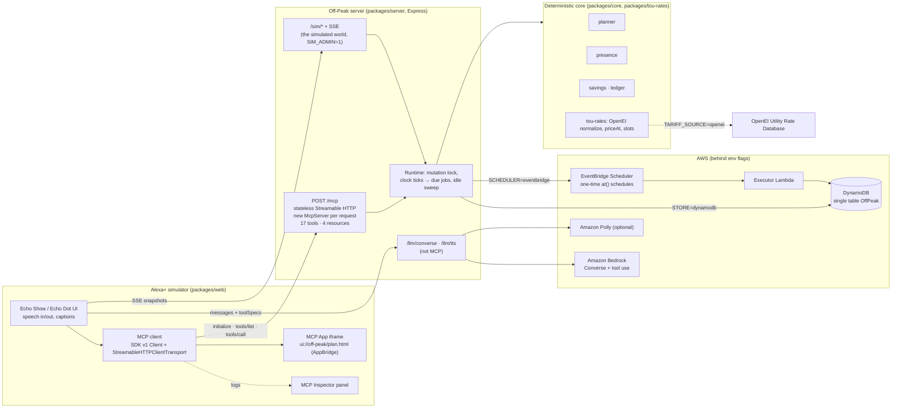

# Off-Peak: cut my power bill without wrecking my evening

**An Alexa+ add-on (self-hosted MCP server) that runs your appliances in the cheapest hours of your real utility rate, turns off power nobody is using, and never breaks a household rule.**

`MCP 2025-11-25` · `Streamable HTTP` · `TypeScript` · `AWS Bedrock · Lambda · DynamoDB · EventBridge Scheduler` · `MIT`

> "I need the car charged by 7, dishes and laundry done tonight, nothing loud after 10."
>
> **Alexa:** "Here's the plan: the washer now, the dryer at 9 PM, and the dishwasher and the car overnight, about $7.74 cheaper than running it all now. Should I go ahead?"


---

## Quick start (zero keys, about 5 minutes)

Requirements: **Node.js 22.18 or newer** (it runs TypeScript natively) and npm.

```bash
git clone https://github.com/Darthh/AWS-Alexa-Hackathon.git
cd AWS-Alexa-Hackathon
npm install
npm run dev            # MCP server on :8787, Alexa+ simulator on :5173
```

Open **http://localhost:5173**, then:

1. Click the first demo chip, or **hold the spacebar and talk**: "I need the car charged by 7, dishes and laundry done tonight, nothing loud after 10."
2. Say **"Do it."**
3. Press **→ 6:45 PM** on the sim clock, then say "We're heading out until 9."
4. Ask "Why did the TV turn off?", then say "Turn it back on."
5. Press **→ 7 AM** and ask "How much did Off-Peak save me today?"

Everything runs offline: synthetic demo rate, simulated home, simulated clock, and a mock LLM. Add `?mode=scripted` to the URL to skip the LLM entirely. That's the backup used for recording the video.

```bash
npm test               # 117 tests: planner golden scenario, DST, MCP protocol, the demo end to end
npm run lint           # strict TypeScript across all packages
npx @modelcontextprotocol/inspector@0.22.0 --cli http://localhost:8787/mcp --transport http --method tools/list
```

---

## What it does

In priority order:

1. **Price-aware scheduling (the headline).** Off-Peak loads the household's real time-of-use rate from the OpenEI Utility Rate Database and plans the EV, dishwasher, washer, and dryer into the cheapest hours. It honors deadlines, quiet hours, washer-before-dryer, and a whole-house load limit. Every plan is compared with "run it all now," in dollars.
2. **Presence-aware on/off.**
   - **Away:** "We're heading out until 9" turns off standby loads and sets cooling back. Cooling comes back on 30 minutes before you return, but never during peak.
   - **Zone:** "It's just me in the office" powers down the other rooms.
   - **Idle-off:** standby devices in empty rooms turn off after 30 minutes.
   - **Return:** when you come back, it restores only what Off-Peak turned off.
3. **Household rules.** Examples: "car at 80% by 7 on weekdays," "nothing loud after 10," "never turn off the fish tank," "ask me before turning off the TV," "stay under 9.6 kW."

**Rules > Presence > Price.** Off-Peak never trades a broken promise for a few cents. The fridge, router, and aquarium are protected server-side, and a running dishwasher is never interrupted mid-cycle.

**Trust is built in.** Every action is in a ledger with a plain-language reason and its dollar impact. `explain` tells you why ("The TV turned off at 6:45 PM because you left home and it was drawing 15 W on standby."), and `undo` restores the exact previous state.

| Away mode at 6:45 PM | Savings at 7 AM | Voice-only (Echo Dot) |
|---|---|---|
|  |  |  |

## Why it's different

Alexa already has building blocks:
- **Hunches** guess when you're away or asleep and can turn off lights or adjust thermostats and water heaters.
- **Routines** run when you leave or arrive, or when you say "I'm heading out."
- **Echo ultrasound occupancy routines** are set up by hand, room by room.
- **Smart Thermostat** nudges the setpoint toward cleaner grid times.
- **The Energy Dashboard** reports usage after the fact.

None of these plan around **the household's actual rate-plan prices**. None **coordinate several appliances against deadlines, quiet hours, and a household load limit**. None **report savings in dollars with a reason for every action**.

Off-Peak does all three in one conversational plan, with undo.

---

## Architecture



**How a turn works:**

1. The browser sends your words and the MCP tool list, mapped to Bedrock `toolSpec`s, to `/llm/converse`.
2. If the model asks for a tool, **the browser itself calls MCP `tools/call`**. It appends the result and loops, up to 5 tool calls per turn.
3. The final text is shown as captions and spoken.
4. UI-bound tool results (`plan_tasks`, `get_home_status`, `get_savings`) render on the Echo Show. The MCP App renders them in an iframe; if it isn't available, the same renderer runs natively.

**Design rules:**

- **Deterministic core.** Pricing, planning, presence, and savings math are plain, unit-tested TypeScript; the planner runs in under 50 ms. LLMs are used only at the edges: understanding the user, parsing natural-language rules, and phrasing.
- **Offline fallbacks everywhere.** There's a demo tariff (plus three real bundled tariffs), a simulated home, a simulated clock, a mock LLM, and scripted mode.

## MCP details

- **Protocol:** `2025-11-25` over **Streamable HTTP**.
  - Uses `@modelcontextprotocol/sdk` **1.32.1**, which keeps the `initialize` handshake that Alexa+ expects.
  - An integration test asserts the negotiated `protocolVersion === "2025-11-25"`.
- **Stateless mode:**
  - `sessionIdGenerator: undefined` and `enableJsonResponse: true`.
  - A fresh `McpServer` and transport per POST, closed when the response closes.
  - All state lives in the store. `GET` and `DELETE` on `/mcp` return 405.
- **Server identity:** name `off-peak`, version `0.1.0`, plus three sentences of `instructions` for routing.
- **Speakable results:**
  - Every tool returns `content` text of at most two short sentences: the decision first, at most one money figure, 12-hour times, no IDs, and "demo rate" when using the demo rate.
  - Every tool also returns `structuredContent` validated against its `outputSchema`.
  - Domain errors return `isError: true` with speakable text, and machine-readable details in `_meta["offpeak/error"]`. See [FRICTION_LOG.md](FRICTION_LOG.md) for why that isn't in `structuredContent`.
- **Device references** like "the car", "living room TV", or "fish tank" are resolved fuzzily on the server. If a reference is ambiguous, the tool asks: "Which one did you mean: the kitchen lights, the floor lamp, the desk lamp, or the bedside lamp?"
- **Security:** CORS is limited to `WEB_ORIGIN`, a host-header check protects against DNS rebinding, every input is validated with Zod, never-off and ask-first rules are enforced server-side, and the sim admin routes are off unless `SIM_ADMIN=1`.

| # | Tool | What it does | Annotations |
|---|---|---|---|
| 1 | `find_rate_plans` | Residential rate plans for a ZIP (OpenEI), TOU first | read-only, open-world |
| 2 | `select_rate_plan` | Switch the household's tariff | idempotent |
| 3 | `get_home_status` | Mode, running, scheduled, price now/next, idle devices | read-only, **UI** |
| 4 | `get_price_now` | Current price, period, and when it changes | read-only |
| 5 | `find_cheapest_window` | Cheapest time for one appliance or N minutes vs. now | read-only |
| 6 | `plan_tasks` | Plan EV/dishwasher/washer/dryer under rules; conflicts come back with priced options | read-only (proposes), **UI** |
| 7 | `apply_plan` | Schedule a proposed plan | idempotent |
| 8 | `cancel_plan` | Cancel a plan, a step, or one appliance | destructive, idempotent |
| 9 | `set_mode` | home / away (+ return time) / sleep / zone (rooms in use) | destructive |
| 10 | `arriving` | Pre-cool (never during peak) and restore at arrival | idempotent |
| 11 | `control_device` | On/off/set; never-off devices need confirmation | destructive |
| 12 | `add_rule` | Natural-language rule → typed rule | — |
| 13 | `list_rules` / `remove_rule` | Show / delete rules | read-only / destructive |
| 14 | `explain` | Why something happened or is scheduled | read-only |
| 15 | `undo` | Restore the exact previous state (one action or a whole mode change) | destructive |
| 16 | `get_savings` | Dollars saved today/week/month: shift, idle, away | read-only, **UI** |

**Resources:**

- `offpeak://tariff/current`, `offpeak://household`, and `offpeak://ledger/today` (all `application/json`).
- `ui://off-peak/plan.html`, an **MCP App** (`text/html;profile=mcp-app`):
  - Registered with `@modelcontextprotocol/ext-apps`' `registerAppResource`.
  - Built as a single self-contained file with no network access, rendered purely from `structuredContent`.
  - Designed for an Echo Show at arm's length: 24 px+ type, high contrast, no hover-only information.
  - The simulator hosts it with ext-apps' `AppBridge` over `postMessage` (`ui/initialize`, `tool-input`, `tool-result`, `resource-teardown`).

## AWS services used and how

| Service | How Off-Peak uses it | Where |
|---|---|---|
| **Amazon Bedrock** (Converse + tool use) | The simulated Alexa's reasoning loop: `/llm/converse` sends messages, the verbatim Alexa+ system prompt, and MCP tools as `toolConfig`. Also the second-chance parser for `add_rule` (JSON validated with Zod), after the deterministic parser. | `packages/server/src/llm/routes.ts`, `adapters/ruleParsers.ts` |
| **AWS Lambda + Function URL** | MCP server (unmodified Express) behind the **AWS Lambda Web Adapter** layer; a second **executor Lambda** runs scheduled jobs. Bundled with Vite SSR, no extra tooling. | `infra/lib/offpeak-stack.ts`, `npm run build:lambda` |
| **Amazon DynamoDB** | Single table `OffPeak`. The partition key is `HH#<householdId>`. Sort keys are `HOUSEHOLD`, `DEVICE#…`, `RULE#…`, `PLAN#…`, `STEP#…`, `LEDGER#<iso>#<id>`, `TARIFF#…`, and `META#…`. | `adapters/dynamoStore.ts` |
| **Amazon EventBridge Scheduler** | One-time `at(yyyy-mm-ddThh:mm:ss)` schedules in the household timezone that invoke the executor Lambda, with `ActionAfterCompletion: DELETE`. Used only with `CLOCK=real`; demos use the sim clock and local scheduler. | `adapters/eventBridgeScheduler.ts`, `lambda/executor.ts` |
| **Amazon Polly** (optional) | Neural TTS for Alexa's voice when `POLLY_VOICE` is set; otherwise the browser voice. | `/llm/tts` |
| **AWS CDK (TypeScript)** | Table, both Lambdas, Function URL with CORS, scheduler role, and least-privilege IAM. | `infra/` |

**Bedrock model:** `BEDROCK_MODEL_ID` ships empty. Run `npm run bedrock:models`; it lists the ACTIVE text models and inference profiles in `AWS_REGION`. Pick one that supports Converse tool use, then set `LLM_MODE=bedrock` and `BEDROCK_MODEL_ID=…`. With no model configured, Bedrock mode answers "Bedrock mode needs BEDROCK_MODEL_ID…" and scripted mode keeps working.

### Deploy (optional; tear it down after testing)

```bash
aws configure                     # or AWS_PROFILE=…
npm run build:lambda              # bundles server + executor + fixtures + MCP App into packages/server/dist-lambda
cd infra && npm install
npx cdk bootstrap                 # once per account/region
npx cdk deploy -c webOrigin=http://localhost:5173 -c llmMode=bedrock -c bedrockModelId=<model-id>
# Point the simulator at the output McpUrl:  VITE_MCP_URL=<McpUrl> npm run dev -w @off-peak/web
npx cdk destroy
```

The Lambda Web Adapter layer version is a CDK context value (`lambdaWebAdapterLayerVersion`, default `25`). Check the current version at [awslabs/aws-lambda-web-adapter](https://github.com/awslabs/aws-lambda-web-adapter). `cdk synth` runs offline and is verified. The deployed stack has not been exercised against a live AWS account. The MCP Function URL is unauthenticated (multi-household auth is in [BACKLOG.md](BACKLOG.md)), so destroy the stack after testing.

## Configuration

Copy `.env.example` to `.env`. Every variable has a working default.

| Variable | Default | Meaning |
|---|---|---|
| `PORT` | `8787` | MCP server port |
| `WEB_ORIGIN` | `http://localhost:5173` | CORS origin for `/mcp`, `/sim`, `/llm` |
| `VITE_MCP_URL` | `http://localhost:8787/mcp` | Where the simulator connects |
| `HOUSEHOLD_TZ` | `America/Los_Angeles` | Household timezone (tariff hours are local) |
| `TARIFF_SOURCE` | `demo` | `demo` (synthetic rate + 3 bundled real plans), `fixture` (default to PG&E E-TOU-C), `openei` (live; falls back to bundled) |
| `OPENEI_API_KEY` | `DEMO_KEY` when `openei` | [Free key](https://openei.org/services/api/signup); NREL's `DEMO_KEY` works but rate-limits fast |
| `CLOCK` | `sim` | `sim` (starts paused at the latest weekday 5:30 PM; `SIM_START` overrides) or `real` |
| `STORE` | `json` | `memory`, `json` (`packages/server/.data/offpeak.json`), `dynamodb` |
| `SCHEDULER` | `local` | `local` (clock ticks run due jobs) or `eventbridge` (+ `EXECUTOR_LAMBDA_ARN`, `SCHEDULER_ROLE_ARN`) |
| `DEVICES` | `sim` | `sim` or `homeassistant` (+ `HA_URL`, `HA_TOKEN`, `fixtures/ha-map.json`) |
| `LLM_MODE` | `mock` | `mock` (zero-cost scripted model) or `bedrock` (+ `AWS_REGION`, `BEDROCK_MODEL_ID`) |
| `POLLY_VOICE` | — | e.g. `Joanna` to speak with Amazon Polly |
| `SIM_ADMIN` | `1` in `npm run dev` | Enables `/sim/*` (clock, people, reset, SSE) |

## Repo layout

```
fixtures/          demo-home.json (20 devices, 6 rooms + whole home), tariffs/ (DEMO_TOU + 3 real OpenEI responses)
packages/
  tou-rates/       standalone MIT library: OpenEI client, normalizer, priceAt/slots/describeDay (no deps on the rest)
  core/            pure domain: types, planner, presence, savings, rule parser, intents, speech helpers
  server/          MCP server, adapters (stores, devices, tariffs, schedulers), sim admin, LLM proxy, Lambda entry points
  ui-apps/         MCP App (plan timeline), single-file build; renderer shared with the web client
  web/             Alexa+ simulator (Vite + React): browser MCP client, Inspector, speech, house/clock/ledger
infra/             AWS CDK stack (optional)
scripts/           dev runner, Bedrock model lister, tou-rates exporter
```

## Testing

- **Golden scenario** (`packages/core/src/planner.test.ts`, `packages/server/test/scenario.golden.test.ts`), on a weekday at 5:30 PM with the demo rate:
  - The washer runs now and the dryer 9–10 PM, after the washer and before quiet hours.
  - The dishwasher and car run overnight in super off-peak, and the car reaches at least 80% by 7 AM.
  - Load never exceeds 9.6 kW, and the plan saves **$7.74**.
  - Then time travel to 7 AM: the car is at 80% and the ledger is filled in.
- **Planner edge cases:** a lower load cap, conflicts with priced options, DST spring-forward, and weekend vs. weekday plans.
- **Protocol:** the negotiated version is `2025-11-25`; there's a raw JSON-RPC `initialize`, plus checks for CORS, the 405s, all 17 tools with annotations and output schemas, and the MCP App resource.
- **Scene 2 end to end:** away mode keeps the fridge, router, and aquarium untouched and the washer running. `explain` and `undo` work on the TV. Pre-cooling waits until 9 PM because of peak, and restore brings back only what Off-Peak changed.
- **Adapters:** DynamoDB single-table round-trips and EventBridge schedule shapes, both with fake clients.
- **Browser:** the full demo script in mock-LLM and scripted modes was driven in headless Chrome during development.

## Limitations

These are honest, and listed in [BACKLOG.md](BACKLOG.md):

- Tier-1 prices only (no baseline allowances, demand charges, or export credits).
- No thermal model; setback savings are labeled estimates and excluded from headline numbers by default.
- The simulator *simulates* Alexa+: hackathon participants can't connect a real Alexa+ device. It is, however, a real MCP client.
- Bedrock and the AWS deployment are implemented but weren't exercised against a live account during the build (no credentials in the dev environment).

## Built during the hackathon

Everything in this repository was written during the Amazon "Build, Ship, Shape" hackathon window (Oct 19–23, 2026), starting from an empty repo. The three OpenEI tariff fixtures are real API responses, retrieved on Oct 19, 2026 and trimmed. See [DECISIONS.md](DECISIONS.md), [FRICTION_LOG.md](FRICTION_LOG.md), [FEEDBACK.md](FEEDBACK.md), and [FEATURE_REQUESTS.md](FEATURE_REQUESTS.md).

## Open source: `tou-rates`

`packages/tou-rates` has zero dependencies on the rest of the repo and its own README and MIT license. `node scripts/export-tou-rates.mjs` produces a standalone repo that installs, tests (21 tests), and builds on its own.

## License

MIT. See [LICENSE](LICENSE).
